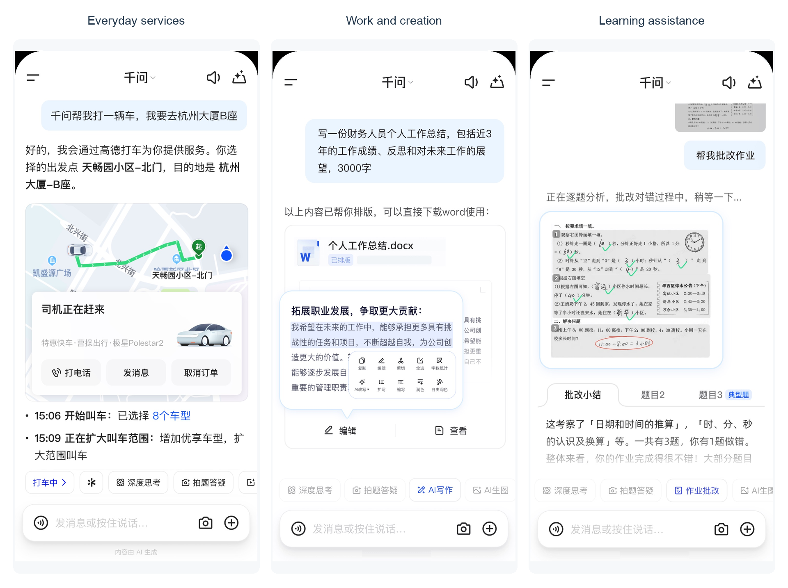
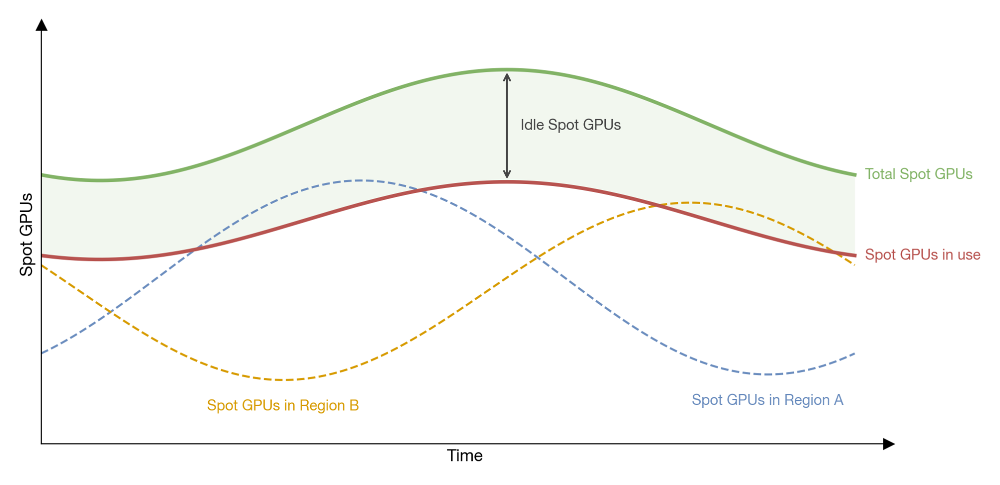
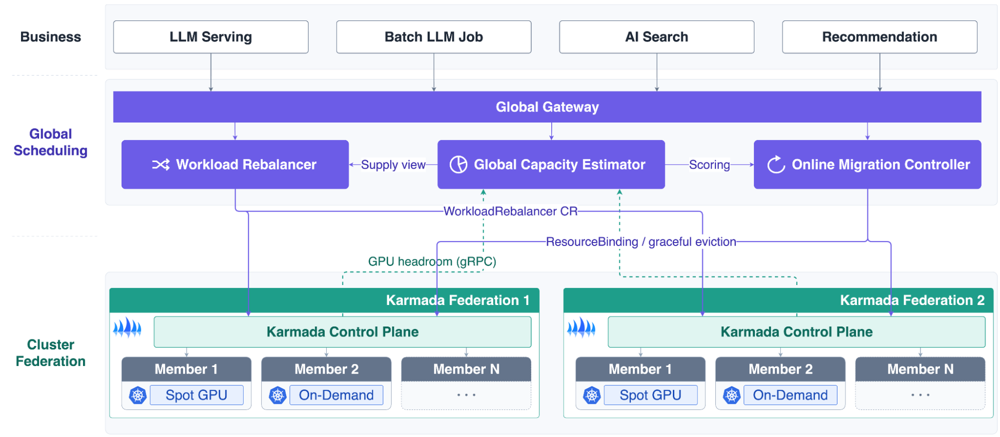
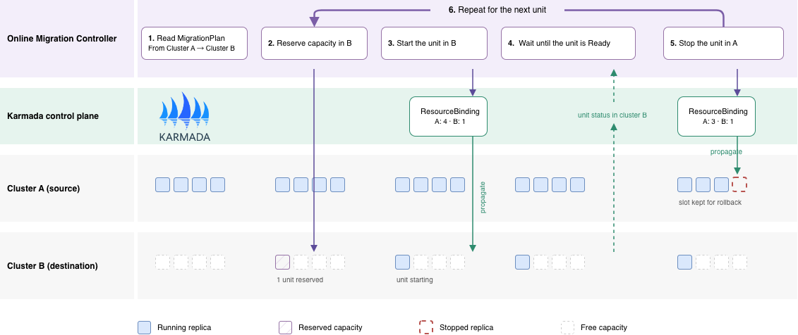
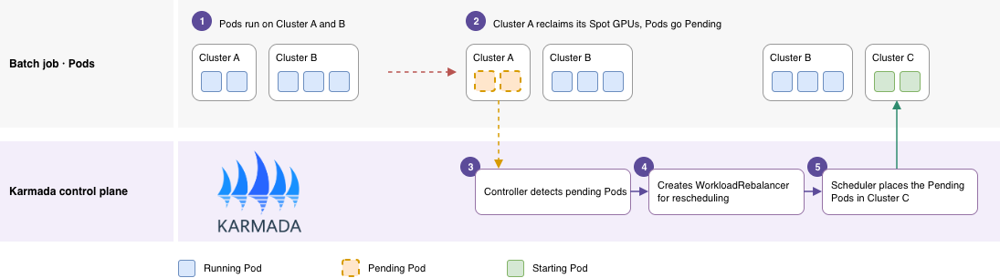

## About Qwen App

Qwen App is Alibaba's flagship consumer AI application. It combines conversational AI with agentic task execution to help users in everyday life, work, and learning. Through its integration with Alibaba's services, users can shop, book travel, make payments, and create content. By February 2026, Qwen's consumer-facing products had passed 300 million monthly active users across all platforms. [1]

*Figure 1. Qwen App use cases in everyday life, work, and learning.*

Qwen App runs many kinds of AI workloads on dozens of Kubernetes clusters. A single cluster's capacity limited how far online services could scale, and Spot GPU reclamation cut offline inference throughput. To use resources better across clusters, the Qwen team built a multi-cluster scheduling layer on Karmada. With global capacity estimation, online service migration, and workload redistribution, the team improved its resource allocation rate by about 15% and Spot GPU utilization by about 30%, and cut cross-cluster migration time from days to minutes.

> "Karmada has become a key part of our multi-cluster AI infrastructure at Qwen App. Its Kubernetes-native resource model and extensibility enable us to coordinate resources around the needs of different AI workloads, maintaining continuity for online services while improving the use of fluctuating GPU capacity for offline inference. This helps us make better use of resources across clusters as our business grows and evolve our scheduling policies based on production needs."
>
> — Jionghang Cai, Team Lead of Cloud Native Infrastructure at Alibaba Qwen App

## The Challenge: Resource fragmentation

Online services need low latency and high availability. Offline inference cares about throughput and cost, so it runs on Spot GPUs that can be reclaimed at any time. Both run across dozens of Kubernetes clusters. Total GPU capacity is usually enough, but it is split by cluster: one cluster runs short while another sits idle. This creates two problems.

### Online services: scaling limits and costly migration

Dependencies on upstream and downstream services limit how replicas can be spread across clusters. When a service needs more capacity than its current cluster can provide, it has to move to a cluster with enough resources without interrupting service. Deploying a full copy in the destination before switching traffic can temporarily double resource use.

### Offline workloads: Spot GPUs come and go

Offline inference can run across clusters and regions, but its Spot GPU capacity changes over time. When online services scale out, one cluster's Spot GPUs may be reclaimed while other clusters still have free resources. If workload placement cannot adapt, inference throughput drops even though GPUs elsewhere sit idle.

*Figure 2. Spot GPU supply changes constantly.*

## The solution: A global scheduling layer on Karmada

The team built a global scheduling layer on top of multiple Karmada instances. A Global Gateway provides a single entry point for workloads including online LLM serving, offline inference, AI search, and recommendation. The global layer has three main extensions:

- **Global Capacity Estimator** checks candidate clusters' capacity against the workload's requirements to guide placement and migration decisions.
- **Online Migration Controller** moves services across clusters according to a migration plan, managing concurrency, readiness checks, and resource reservation.
- **Workload Rebalancer** handles offline workload rescheduling requests.

Each Karmada instance manages its own member clusters; the global layer coordinates across them.

*Figure 3. The global scheduling layer coordinates multiple Karmada instances.*

### Rolling migration for online services

The team splits a service into units that can be moved independently, based on how the workload is organized. A migration plan specifies the source and destination clusters, a concurrency limit, and a stability window.

*Figure 4. Rolling migration across clusters.*

The migration controller moves one unit at a time. It reserves capacity in the destination, starts the unit there, and waits until the unit is Ready and stays Ready for the stability window. Only then does it stop the matching unit in the source, keeping that slot until the migration is confirmed so a rollback always has the resources it needs. The next unit follows, until the whole service is in the destination.

Moving one unit at a time keeps the temporary overhead small: the service never runs two full copies, and a failed unit can be rolled back without touching the rest.

### Cross-cluster rescheduling for offline inference

For offline inference, a rescheduling controller periodically checks member clusters for Pods that have no node. When Spot reclamation or a capacity shortage leaves Pods Pending, the controller creates a WorkloadRebalancer request for that workload. The Karmada scheduler keeps the Pods that already run and recalculates placement only for the Pending ones, using capacity estimates and workload constraints such as GPU type and GPUs per instance.

*Figure 5. Rescheduling pending Pods across clusters.*

Figure 5 shows an example: Cluster A reclaims its Spot GPUs, its Pods go Pending, and the scheduler places them in Cluster C, which has free Spot GPUs, while Cluster B is untouched.

Rescheduling only the Pending Pods avoids the model reloading, cache rebuilding, and task interruption that moving running Pods would cause.

## Results and benefits

In production, the new architecture has delivered the following results:

- **Resource allocation rate improved ~15%.** Cross-cluster capacity estimation and allocation let the team use free resources elsewhere when one cluster hits its limit, reducing the impact of local shortages on business growth.
- **Spot GPU utilization improved ~30%.** The team recalculates cross-cluster allocations for offline demand that is still waiting for a node, while keeping existing allocations as the baseline. Compatible Spot GPUs in other clusters can then join the work, making better use of changing capacity.
- **Migration time from days to minutes.** The migration controller coordinates resource reservation, batched execution, and readiness checks. This cuts the time needed to move services across clusters while keeping unit size, concurrency, and rollback under control.

## Why Karmada?

The Qwen team chose Karmada because it fits its existing Kubernetes environment and is easy to extend.

- **Compatibility with native Kubernetes APIs.** Karmada uses the Kubernetes resource model and APIs [2]. This let the team reuse its existing toolchain and keep application changes small when moving onto the multi-cluster platform.
- **Resource-oriented multi-cluster orchestration.** Karmada supports resource propagation, cluster selection, and replica allocation [3], and keeps resource templates separate from scheduling policies. The team can change a workload's cluster distribution through policy without touching its application definition.
- **Extensibility for AI workload policies.** Online migration needs resource reservation, stability checks, and rollback control. Offline rescheduling needs to keep existing allocations and fill unmet replica demand. Karmada's extension points let the team build both as custom controllers without forking the project.

In this design, Karmada handles general multi-cluster resource orchestration, while the team's extensions make scheduling decisions and control changes for AI workloads. Online migration and offline rescheduling share Karmada's resource management but have their own behavior and can evolve independently.

## What's next

The Qwen team is bringing its production experience back to the Karmada community. Two proposals are already under discussion:

- **Best-effort propagation** ([karmada-io/karmada#8030](https://github.com/karmada-io/karmada/issues/8030)). Today, Karmada propagates a multi-component workload only when a cluster can fit all of it. The proposal lets Karmada pick the best-fit cluster and propagate the full workload anyway, so the member cluster can schedule what fits now and use the remaining demand to drive local defragmentation.
- **WorkloadSet** ([karmada-io/karmada#8026](https://github.com/karmada-io/karmada/issues/8026)). Disaggregated inference services consist of several workloads, such as prefill, decode, and routing, that must land in the same cluster. WorkloadSet groups existing workloads so Karmada can evaluate their combined capacity and schedule them together.

Beyond these, the team plans to share its migration and rescheduling controllers as reference implementations and to keep contributing scheduling improvements for AI workloads.

## References

1. Alibaba Group. [Alibaba Reports Solid Progress in AI + Cloud on the Strength of Its Full-Stack Capabilities](https://home.alibabagroup.com/en-US/document-1971445322303406080). March 19, 2026.
2. Karmada. [Karmada Documentation](/docs/).
3. Karmada. [Features](/docs/key-features/features).
