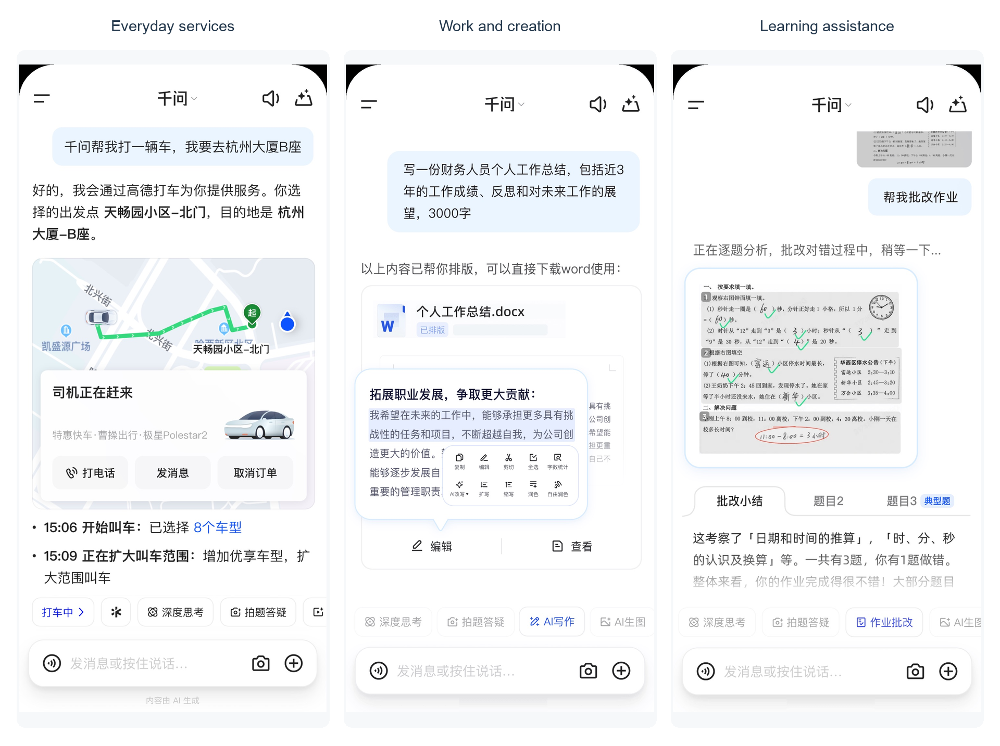
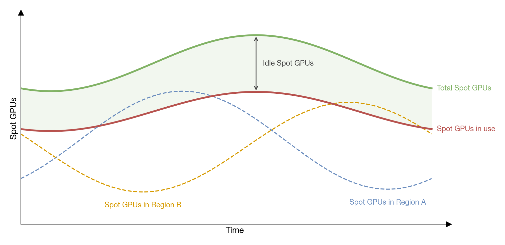
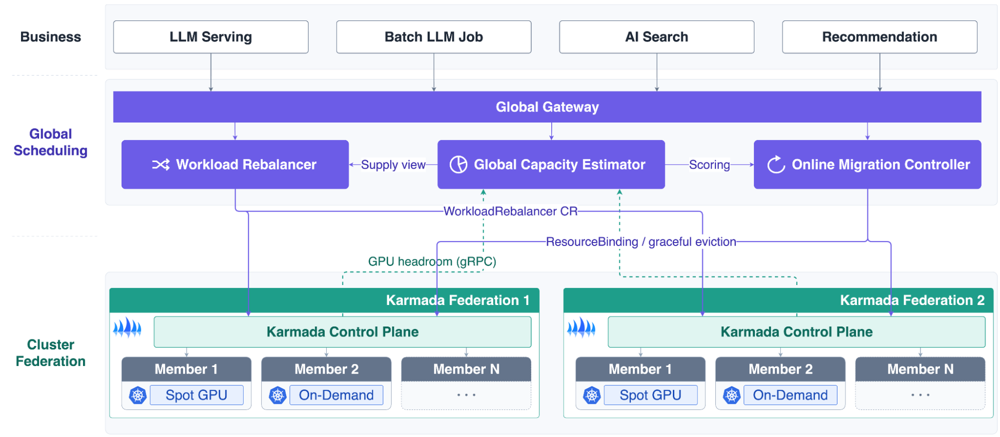
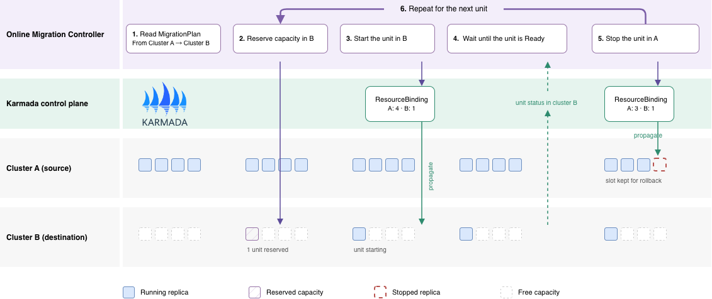
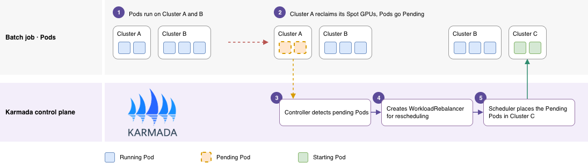

## 关于千问 App

千问 App 是阿里巴巴的旗舰消费级 AI 应用。它将对话式 AI 与智能体任务执行相结合，帮助用户处理日常生活、工作和学习中的各类需求。通过与阿里巴巴生态服务的集成，用户可以购物、预订行程、完成支付以及创作内容。截至 2026 年 2 月，千问面向消费者的产品在全平台的月活跃用户已突破 3 亿。[1]

*图 1. 千问 App 在生活、工作和学习中的使用场景。*

千问 App 在数十个 Kubernetes 集群上运行多种 AI 工作负载。单集群容量限制了在线服务的扩容上限，Spot GPU 被回收则会拉低离线推理的吞吐。为了在集群之间更充分地利用资源，千问团队基于 Karmada 构建了多集群调度层。借助全局容量评估、在线服务迁移和工作负载重分配，团队将资源分配率提升约 15%、Spot GPU 利用率提升约 30%，并将跨集群迁移时间从数天缩短到分钟级。

> "Karmada 已成为千问 App 多集群 AI 基础设施的关键组成部分。它的 Kubernetes 原生资源模型和良好的可扩展性，让我们能够围绕不同 AI 工作负载的需求来协调资源：既保障在线服务的连续性，又更充分地利用波动的 GPU 容量来服务离线推理。随着业务增长，这帮助我们在集群间更好地利用资源，并根据生产需要持续演进调度策略。"
>
> —— 蔡迥航，阿里巴巴千问 App 云原生基础设施团队负责人

## 挑战：资源碎片化

在线服务需要低延迟和高可用；离线推理更关注吞吐和成本，因此运行在随时可能被回收的 Spot GPU 上。两类负载都分布在数十个 Kubernetes 集群中。GPU 总容量通常是够用的，但被集群边界切开：一个集群资源紧张的同时，另一个集群却在空转。由此带来两个问题。

### 在线服务：扩容受限，迁移代价高

上下游服务之间的依赖限制了副本在集群间的分布方式。当服务需要的容量超过当前集群所能提供的，它就必须在不中断服务的前提下整体迁到资源充足的集群。先在目标集群部署一份完整副本再切流量，会在一段时间内使资源占用翻倍。

### 离线负载：Spot GPU 来去无常

离线推理可以跨集群、跨地域运行，但 Spot GPU 容量随时间变化。在线服务扩容时，某个集群的 Spot GPU 可能被回收，而其他集群仍有空闲资源。如果工作负载的放置无法随之调整，推理吞吐就会下降，尽管别处的 GPU 正在闲置。

*图 2. Spot GPU 供给持续变化。*

## 方案：基于 Karmada 的全局调度层

团队在多个 Karmada 实例之上构建了全局调度层。Global Gateway 为在线 LLM 推理、离线推理、AI 搜索和推荐等工作负载提供统一入口。全局层包含三个主要扩展：

- **Global Capacity Estimator**：根据工作负载的需求评估候选集群的容量，为放置和迁移决策提供依据。
- **Online Migration Controller**：按照迁移计划在集群间迁移服务，管理并发度、就绪检查和资源预留。
- **Workload Rebalancer**：处理离线工作负载的重调度请求。

每个 Karmada 实例管理自己的成员集群，全局层负责跨实例协调。

*图 3. 全局调度层协调多个 Karmada 实例。*

### 在线服务的滚动迁移

团队根据工作负载的组织方式，将服务拆分为可以独立迁移的单元。迁移计划指定源集群与目标集群、并发上限以及稳定观察窗口。

*图 4. 跨集群滚动迁移。*

迁移控制器一次只迁移一个单元。它先在目标集群预留容量，在那里启动该单元，等待其进入 Ready 状态并在整个稳定窗口内保持 Ready。只有到那时，它才停止源集群中对应的单元，并保留该位置直到迁移被确认，以保证回滚时始终有足够资源。随后迁移下一个单元，直至整个服务都落在目标集群。

一次只迁一个单元，临时开销很小：服务从不会同时运行两份完整副本，失败的单元也可以单独回滚而不影响其余部分。

### 离线推理的跨集群重调度

对于离线推理，重调度控制器周期性地检查成员集群中尚未绑定节点的 Pod。当 Spot 回收或容量不足导致 Pod 处于 Pending 时，控制器为该工作负载创建一个 WorkloadRebalancer 请求。Karmada 调度器保留已经运行的 Pod，只为 Pending 的 Pod 重新计算放置，计算时综合容量评估结果以及 GPU 型号、单实例 GPU 数等工作负载约束。

*图 5. 跨集群重调度 Pending Pod。*

图 5 给出了一个例子：集群 A 回收了 Spot GPU，其上的 Pod 进入 Pending；调度器将这些 Pod 放到有空闲 Spot GPU 的集群 C，集群 B 不受影响。

只重调度 Pending 的 Pod，避免了迁移运行中 Pod 所带来的模型重新加载、缓存重建和任务中断。

## 成果与收益

新架构在生产环境中取得了以下成果：

- **资源分配率提升约 15%。** 跨集群容量评估与分配让团队在某个集群达到上限时，可以使用其他集群的空闲资源，减少局部短缺对业务增长的影响。
- **Spot GPU 利用率提升约 30%。** 团队以既有分配为基线，只为仍在等待节点的离线需求重新计算跨集群分配。其他集群中兼容的 Spot GPU 由此得以投入工作，更好地利用不断变化的容量。
- **迁移时间从数天缩短到分钟级。** 迁移控制器协调资源预留、分批执行和就绪检查，在控制单元大小、并发度和回滚的同时，大幅缩短了跨集群迁移服务所需的时间。

## 为什么选择 Karmada？

千问团队选择 Karmada，是因为它契合现有的 Kubernetes 环境，且易于扩展。

- **兼容 Kubernetes 原生 API。** Karmada 沿用 Kubernetes 的资源模型和 API [2]。团队得以复用现有工具链，迁移到多集群平台时对应用的改动很小。
- **面向资源的多集群编排。** Karmada 支持资源分发、集群选择和副本分配 [3]，并将资源模板与调度策略分离。团队可以通过策略调整工作负载的集群分布，而无需改动应用定义。
- **面向 AI 工作负载策略的可扩展性。** 在线迁移需要资源预留、稳定性检查和回滚控制；离线重调度需要保留既有分配并只补齐缺口。Karmada 的扩展点让团队以自定义控制器的形式实现这两套机制，而无需 fork 项目。

在这一设计中，Karmada 负责通用的多集群资源编排，团队的扩展负责面向 AI 工作负载的调度决策与变更控制。在线迁移与离线重调度共用 Karmada 的资源管理能力，但各自拥有独立的行为，可以独立演进。

## 下一步

千问团队正在把生产经验回馈给 Karmada 社区，目前有两个提案正在讨论中：

- **Best-effort propagation**（[karmada-io/karmada#8030](https://github.com/karmada-io/karmada/issues/8030)）。目前，Karmada 只有在某个集群能完整容纳多组件工作负载时才会分发。该提案允许 Karmada 选择最合适的集群并直接分发完整的工作负载，成员集群先调度当前能容纳的部分，并利用剩余需求驱动本地资源碎片整理。
- **WorkloadSet**（[karmada-io/karmada#8026](https://github.com/karmada-io/karmada/issues/8026)）。PD 分离的推理服务由 prefill、decode、routing 等多个工作负载组成，它们必须落在同一个集群。WorkloadSet 将已有的工作负载打包成组，让 Karmada 能够评估它们的合并容量并一起调度。

此外，团队计划将迁移与重调度控制器作为参考实现分享出来，并持续为 AI 工作负载贡献调度方面的改进。

## 参考资料

1. Alibaba Group. [Alibaba Reports Solid Progress in AI + Cloud on the Strength of Its Full-Stack Capabilities](https://home.alibabagroup.com/document-1971445322303406080). 2026 年 3 月 19 日。
2. Karmada. [Karmada 文档](/zh/docs/)。
3. Karmada. [特性](/zh/docs/key-features/features)。
